Banua Coder is a small software company in Palu, Indonesia. We ship a mobile finance app, a Flutter starter kit, a telemetry service, public APIs, a bus tracker, and our own website. A small team can keep that going only with one way of working.

This post shows that way of working from end to end. It starts with how every product ships. Then it covers five more parts: the secret vault for people and AI agents, the operations platform that runs our company, signed documents that anyone can verify, the guide that fills our Coretax tax return, and what our clients see while we work.

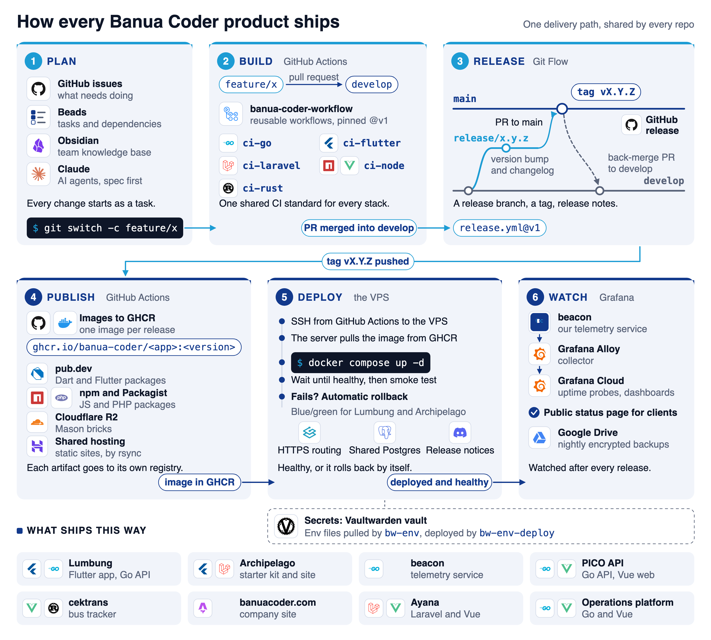

## One delivery path for every product

Every repository follows the same six stages. The tools differ by stack, but the path does not.

Plan. Work starts as a task in Beads, our issue tracker, or as a GitHub issue. Our team notes live in an Obsidian vault. AI agents help, and the rule is spec first: a short written spec comes before code.

Build. Work happens on a feature branch and goes into `develop` through a pull request. The checks come from our own repository of reusable GitHub Actions workflows, pinned to a version tag. There is one workflow per stack: Go, Flutter, Laravel, Node, and Rust.

Release. We use Git Flow. A `release/x.y.z` branch bumps the version and writes the changelog. A pull request takes it to `main`. The merge creates a version tag and a GitHub release. Then a back-merge pull request brings the release commit back to `develop`.

Publish. Each artifact goes to its own registry. Docker images are built in GitHub Actions and pushed to the GitHub container registry. Dart and Flutter packages go to pub.dev. JavaScript packages go to npm, PHP packages to Packagist, and our Mason bricks to Cloudflare R2. Static sites are copied to shared hosting.

Deploy. GitHub Actions connects to the server over SSH. The server pulls the image from the registry, so the runner never uploads image bytes. Docker Compose starts it, and the script waits until the container is healthy. A smoke test then checks the live site. If anything fails, the script rolls back to the previous version. Lumbung and Archipelago deploy blue and green. Traefik gives every app HTTPS.

Watch. Our own telemetry service, beacon, sends data through Grafana Alloy to Grafana Cloud. That gives us uptime probes and dashboards. Nightly backups go to cloud storage. Releases of Archipelago post a notice to Discord.

One rule keeps this honest: nobody builds an image on a laptop and copies it to the server. We broke that rule once with the operations platform, which we describe below. We noticed, fixed it, and moved it onto the same path. It now ships like everything else.

## Part 1: The secret vault

The first problem in any team is not the platform. It is secrets. Keys sit in chat messages, in `.env` files copied by hand, and in shared notes. When someone leaves, the keys stay.

We host Vaultwarden. It speaks the Bitwarden protocol, so staff use the official `bw` command line tool. Five rules shape the design:

1. One secure note per project and environment, named like `lumbung/.env.staging`. The fields of the note are the variable names.
2. Access is per collection. A person sees only the projects they work on. To remove access, the owner deletes the person from the collection and then rotates the secrets that person can read.
3. One command pulls a note into a local file. We never commit that file.
4. The installer is signed. The owner signs the scripts with a key that never goes on the server. The installer installs nothing unless the signature is valid and each file matches its SHA-256 in the signed list.
5. A server `.env` is deployed from the vault note, never edited by hand. The command `bw-env-deploy` first shows what will change by variable name. It never prints values. It writes nothing until you add `--apply`.

### How an engineer or a freelancer gets the env of a project

A new engineer or freelancer needs the `.env` of one project and nothing else. We built three small commands on top of the Bitwarden CLI for this. The diagram below shows the whole path, step by step.

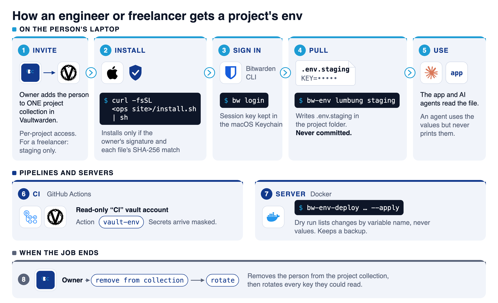

1. The owner invites the person to the vault and adds them to the collection of that project. Our advice for a freelancer is the staging collection only, with low-privilege keys.
2. The person runs the signed installer from our ops site: `curl -fsSL https://<ops-host>/install.sh | sh`. It installs the Bitwarden CLI and our commands, and it stops if the owner's signature or any file hash does not match.
3. The person runs `bw login`. The session key stays in the macOS Keychain, so there is no password prompt every time.
4. The person runs `bw-env lumbung staging`. The command writes `.env.staging` in the project folder, and that file is never committed.
5. When the job ends, the owner removes the person from the collection and rotates the keys that the person can read.

There are three commands. `bw-env` pulls a note into a file. `bw-env-push` creates a note from an existing `.env` file. `bw-env-deploy` makes a server file match a note. `bw-env-push` creates one hidden field per variable and never overwrites a note. With `--update` it lists the added, changed, and removed variable names before it changes anything.

Our pipelines use a separate vault account with read-only access to one collection named `CI`. That collection holds only what the pipelines need, never production secrets. A small GitHub Action turns each field of a note into a masked environment variable.

Now the AI agents. They work in the same shell as the developer, so they face the same risk. Our rule is that an agent can use a value but never reads or prints it. The agent runs `bw-env`, the file lands on disk, and the program reads it. Values do not enter a prompt or a chat. The dry run shows names only, which gives an agent what it needs to reason about a change.

This is a rule, not a wall. An agent that can run shell commands can read any file the developer can read. That is why access is per project, and why we rotate secrets whenever we have a doubt.

## Part 2: One platform for the whole client cycle

We did not find a tool that handled our Indonesian practice together. That practice includes PPh 23 withholding by clients, the Kurs KMK exchange rate, bea meterai stamp duty, and the BAST and SPPT handover documents. So we built the operations platform. It is one Go program with the Vue interface inside it. It uses a shared Postgres database, and sign-in goes through our own identity provider, Rauthy.

The platform follows one client from first contact to the final invoice:

- Clients, with a portal where the client signs in and sees the project.
- Proposals, NDAs, and contracts, made from templates in Bahasa Indonesia or English.
- Invoices in several currencies, with PPh 23 and the Kurs KMK of the issue date.
- A double-entry ledger. Entries are never edited. A correction is a reversal.
- Projects with a stage before the work, a stage after it, and milestones.

Documents link to each other: NDA, proposal, contract, invoice, BAST, SPPT. From any document you can create the next one with the data filled in. When a contract is signed, the platform creates the onboarding document and invites the client to the portal. When a project is complete, it creates the handover documents.

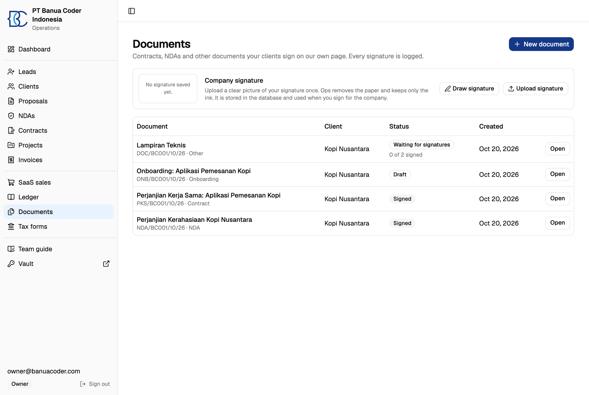

Real email goes out only when the setting `APP_ENV=production` exists, and only the server has it. Everywhere else the platform uses a sandbox inbox that catches every message. A laptop or a test cannot email a client.

## Part 3: Signing with a public trail

We first looked at a hosted signing tool. Embedding it was a paid feature, and it needed about 2 GB of memory on our small server. So we built signing into the platform.

The diagram below shows the flow. Each signer receives a private link. If a document states an amount over Rp 5,000,000, it needs a bea meterai. The owner types the serial from Peruri. The platform does not call Peruri. Every action goes into an append-only audit trail: who, when, from which address, on which device.

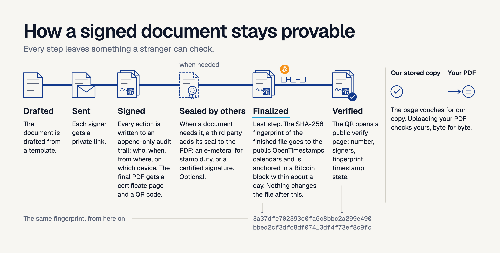

When the last signer finishes, the platform makes the final PDF. It adds a certificate page and a QR code, and it stores the SHA-256 fingerprint of the file. It sends that fingerprint to the public OpenTimestamps calendars. They anchor it in a Bitcoin block within about a day. After that, nobody can claim the file was made later than that block.

The QR code opens a public verify page. It shows the document number, the signers, the fingerprint, and the state of the timestamp. The title stays hidden unless the owner allows it, because the title of an NDA can be confidential.

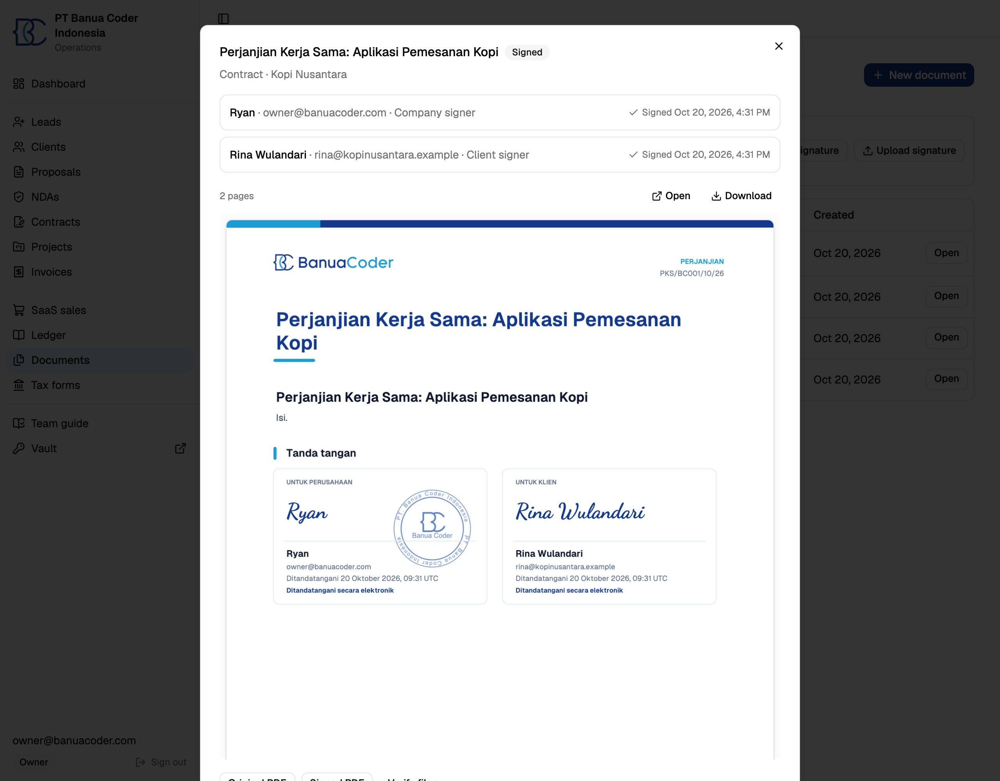

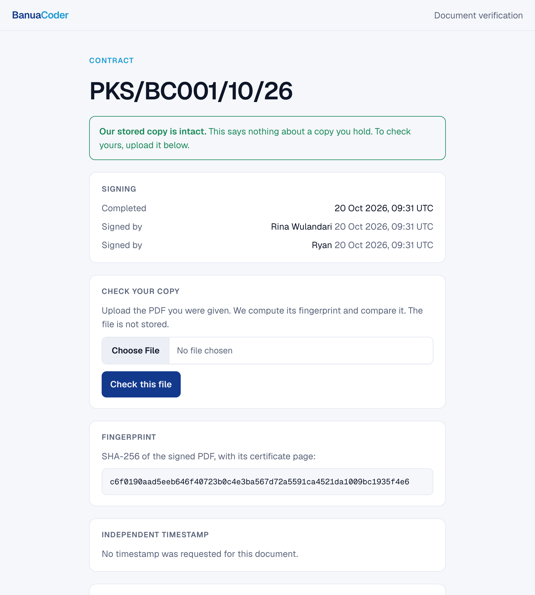

We made one mistake here. At first the page showed a green "valid" mark. But it checked the copy that our server stores, not the PDF in the reader's hand. A changed PDF with a working QR code would still lead to a green page. Now the page says "our stored copy is intact". A form lets the reader upload their own PDF. The server hashes it and compares it byte for byte, then drops the file.

One honest limit. These are uncertified electronic signatures under Indonesian law (UU ITE). They are valid, but they carry less evidential weight than signatures from a certified provider. A lawyer must review every template. We state this in the platform.

## Part 4: The Coretax guide

This is the part we are most glad we built.

Every year the tax return was the hardest day. The old DJP forms were Adobe XFA forms. On a Mac they show a blank "Please wait" screen. We wrote a parser for them and filled them from our books. Then DJP moved filing to Coretax, a web system with long forms. So we changed the target.

The Tax forms page now makes everything from the ledger for the year you pick:

- The Coretax guide. It follows the Coretax screens question by question, with the answer to type next to each question.
- The supporting PDFs: financial statements, trial balance, journal, general ledger, cost detail, revenue summary, PPh 23 credits, and prepaid costs.
- A zip of CSV files for a tax consultant.
- The annual figures, including a loss carried forward from earlier years.

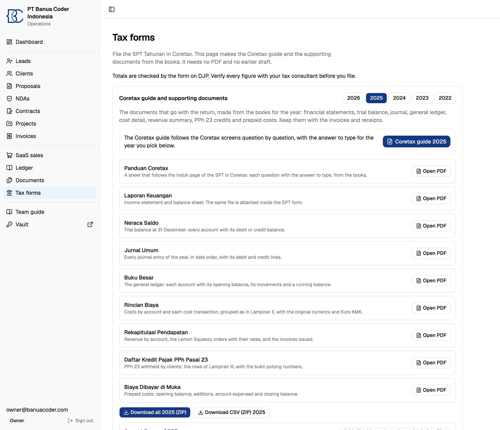

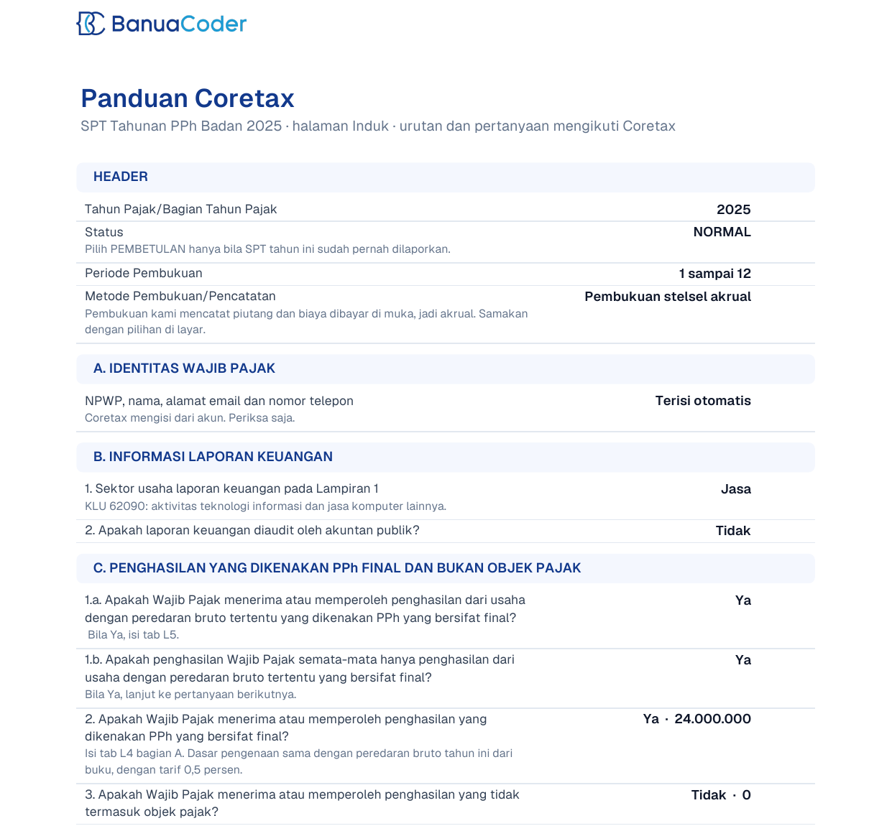

The platform knows which tax regime applies in each year and shows the figures for that regime. It never files anything. Every figure carries a "verify before filing" mark, and a person who knows tax must check the numbers before you submit. We never show a computed tax figure as final.

We learned one thing the hard way. Coretax showed a parsing error when one field held no number. The guide now prints an explicit zero in every cell. It prints a negative number with a minus sign, because brackets once led us to type the wrong sign.

## Part 5: What our client sees

For a client, the first weeks with a new vendor are the hardest. They do not know what happens next, who owes what, or whether the work moves. We wanted a client to see the answer to those three questions without asking us.

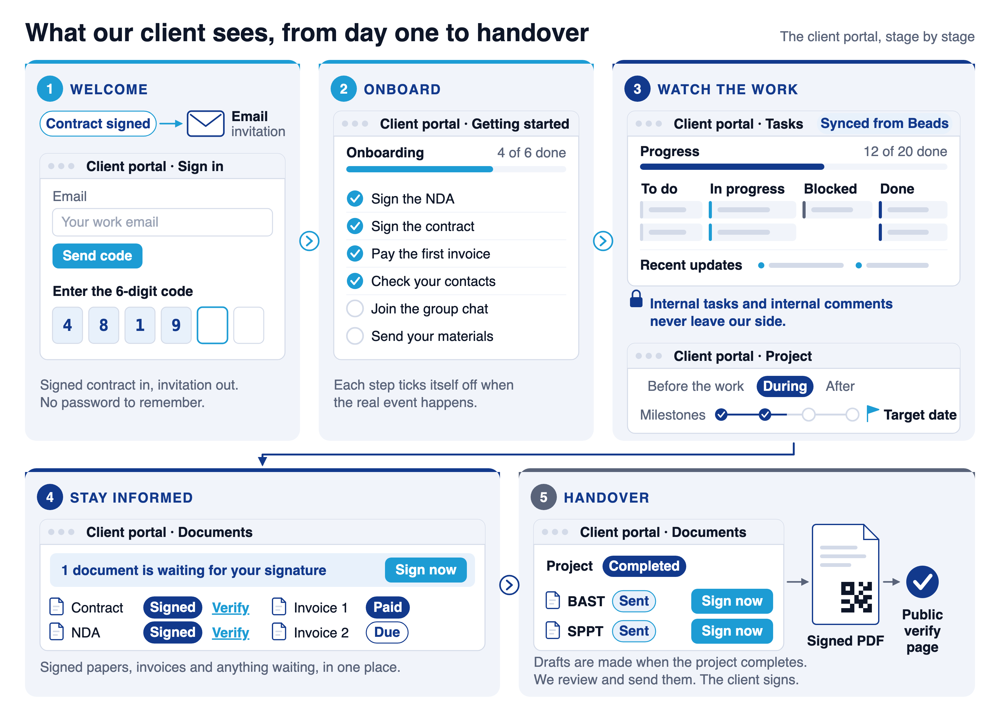

It starts the moment a contract is signed. The platform creates the client portal and sends an invitation by email.

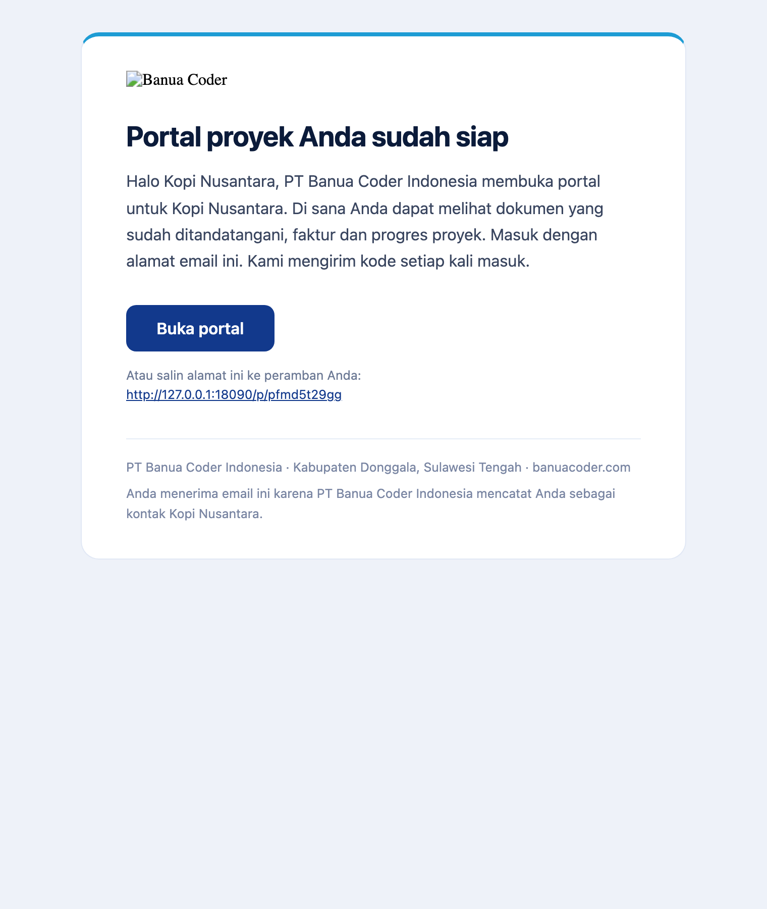

The client enters their email address and receives a six-digit code. There is no password to remember. The first page they see is an onboarding checklist. Some steps tick themselves from real events: the contract is signed, the NDA is signed, the first invoice is paid. Others the client ticks: check the contacts, join the group chat. Our own steps, such as receiving the client materials, show too.

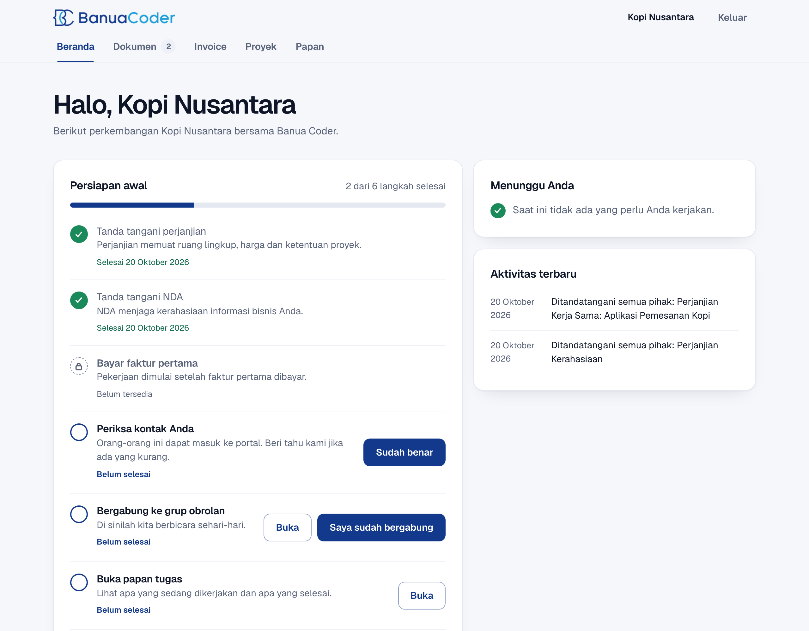

Then the client can watch the work. The Board tab is the real task list of the project. We keep it in Beads, and a small script syncs a snapshot to the portal. It shows progress, four columns, priorities, who works on what, and a feed of recent updates. The sync has privacy rules built in. A task with the label `internal` never leaves our side. A comment that starts with `internal:` is dropped. The owner email never goes out. A task shows only when we label it `client-visible`.

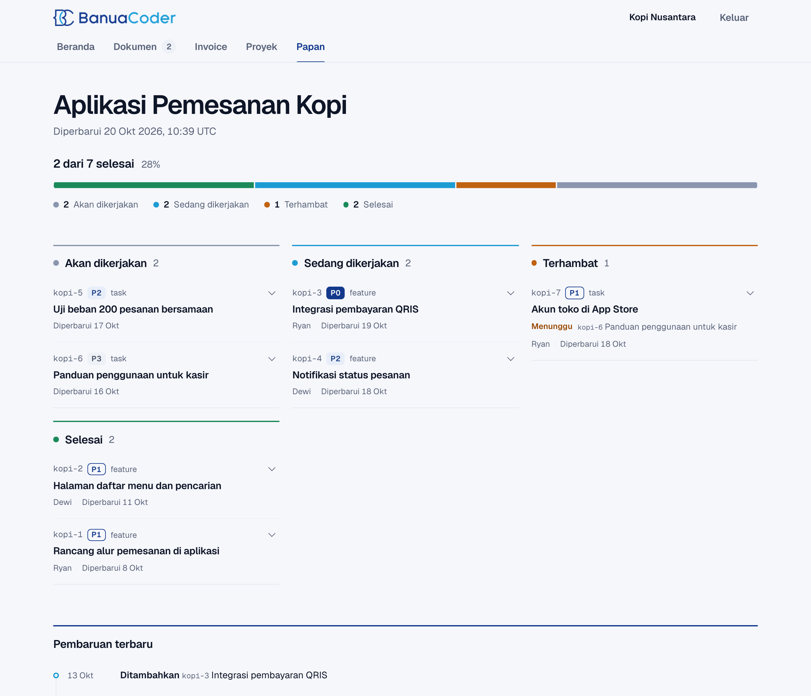

The Project tab shows the bigger picture: what happens before the work, during it, and after it. It lists the milestones and the target date. Documents and invoices sit in their own tabs, and anything that waits for the client has a Sign now button. When the project completes, the platform drafts the BAST and SPPT handover documents. We review them and send them, the client signs, and the signed PDF carries the QR code from Part 3.

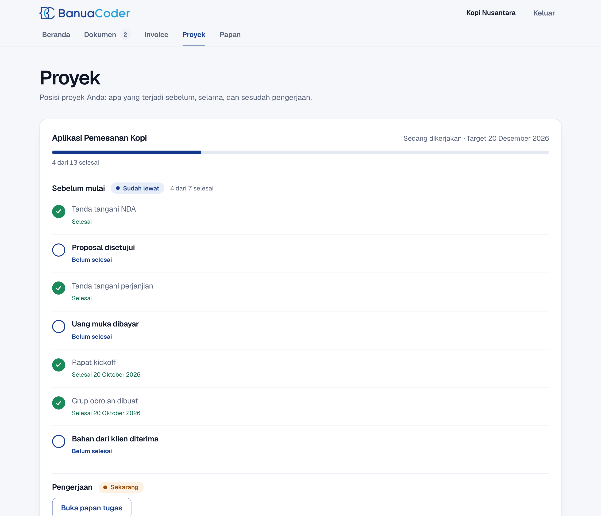

## Before you copy this

1. Start with the ledger. Invoices, reports, and tax forms all read from it.
2. Make every check look at the thing in the reader's hand, not only at your own copy.
3. Never show a computed tax figure as final.
4. Keep deploys boring and the same everywhere. One path for every product beats one clever script per app.
5. Design what the client sees on day one. A checklist that ticks itself costs little and removes many questions.
6. Own a system only if you can maintain it. The cost is our time, not a subscription.

Banua Coder builds internal operations systems like this for companies and public agencies. If you want one, book a call at banuacoder.com.
