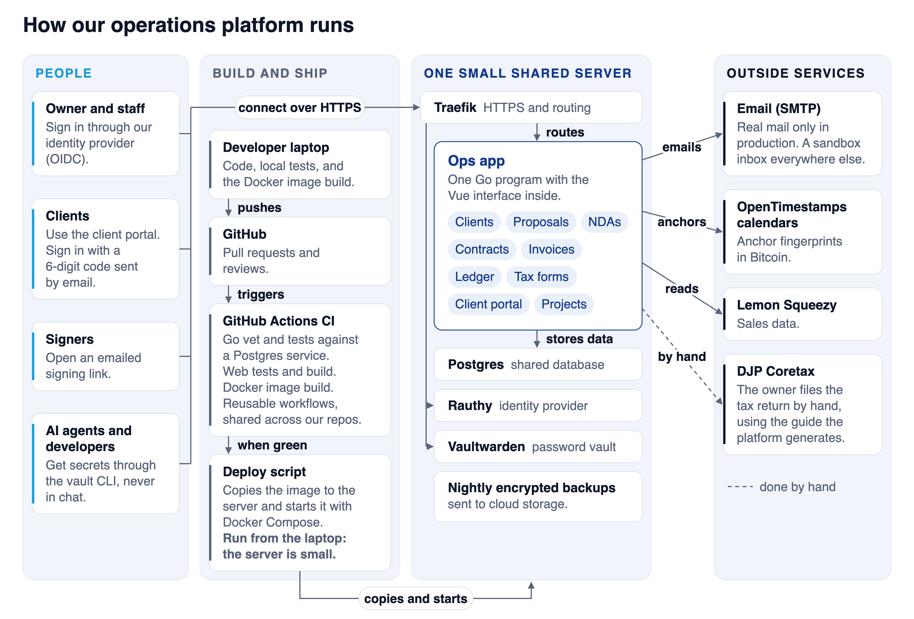

Banua Coder is a small software company in Palu, Indonesia. We have clients, contracts, invoices, a yearly tax return, and a team that is starting to grow. For a long time this work lived in many tools and in the memory of one person. That breaks the day that person is on leave.

So we built our own operations center. It is one small program that runs on one shared server. It holds our clients, documents, books, and tax forms. This post shows how it works and what we chose. It covers four parts: the secret vault, the operations platform, signed documents that anyone can verify, and the guide that fills our Coretax return.

## Why we did not buy four more tools

Most tools we looked at solve one slice. Invoices live in one place, contracts in another, books in a third. Each has a monthly fee. We did not find one that handled our Indonesian practice together. That practice includes PPh 23 withholding by clients, the Kurs KMK exchange rate, bea meterai stamp duty, and the BAST and SPPT handover documents.

Our server is small and shared with other services. So we wanted one light program, not a stack. The platform is one Go program with the Vue interface inside it. It uses the shared Postgres database. Sign-in goes through our own identity provider, Rauthy.

## Part 1: The secret vault

Our first problem was not the platform. It was secrets. Keys sat in chat messages, in `.env` files copied by hand, and in shared notes. When someone leaves, the keys stay.

We host Vaultwarden. It speaks the Bitwarden protocol, so staff use the official `bw` command line tool. Five rules shape the design:

1. One secure note per project and environment, named like `lumbung/.env.staging`. The fields of the note are the variable names.
2. Access is per collection. A person sees only the projects they work on. To remove access, the owner deletes the person from the collection and then rotates the secrets that person can read.
3. One command pulls a note into a local file. For example, `bw-env lumbung staging` writes `.env.staging`. We never commit that file.
4. The installer is signed. The owner signs the scripts with a key that never goes on the server. The installer installs nothing unless the signature is valid and each file matches its SHA-256 in the signed list.
5. A server `.env` is deployed from the vault note, never edited by hand. The command `bw-env-deploy` first shows what will change by variable name. It never prints values. It writes nothing until you add `--apply`.

Our pipelines use a separate vault account with read-only access to one collection named `CI`. That collection holds only what the pipelines need, never production secrets. A small GitHub Action turns each field of a note into a masked environment variable.

Now the AI agents. They work in the same shell as the developer, so they face the same risk. Our rule is that an agent can use a value but never reads or prints it. The agent runs `bw-env`, the file lands on disk, and the program reads it. Values do not enter a prompt or a chat. The dry run shows names only, which gives an agent what it needs to reason about a change.

This is a rule, not a wall. An agent that can run shell commands can read any file the developer can read. That is why access is per project, and why we rotate secrets whenever we have a doubt.

## Part 2: One platform for the whole cycle

The platform follows one client from first contact to the final invoice:

- Clients, with a portal where the client signs in and sees the project.
- Proposals, NDAs, and contracts, made from templates in Bahasa Indonesia or English.
- Invoices in several currencies, with PPh 23 and the Kurs KMK of the issue date.
- A double-entry ledger. Entries are never edited. A correction is a reversal.
- Projects with a stage before the work, a stage after it, and milestones.

Documents link to each other: NDA, proposal, contract, invoice, BAST, SPPT. From any document you can create the next one with the data filled in. When a contract is signed, the platform creates the onboarding document and invites the client to the portal. When a project is complete, it creates the handover documents.

The client portal replaced a secret link. A client enters an email address and receives a six-digit code. After that they see an onboarding checklist, their documents, their invoices, and the task board. The checklist completes itself from real data, so a signed NDA ticks its own step.

## Part 3: Signing with a public trail

We first looked at a hosted signing tool. Embedding it was a paid feature, and it needed about 2 GB of memory on our small server. So we built signing into the platform.

The diagram below shows the flow. Each signer receives a private link. If a document states an amount over Rp 5,000,000, it needs a bea meterai. The owner types the serial from Peruri. The platform does not call Peruri. Every action goes into an append-only audit trail: who, when, from which address, on which device.

When the last signer finishes, the platform makes the final PDF. It adds a certificate page and a QR code, and it stores the SHA-256 fingerprint of the file. It sends that fingerprint to the public OpenTimestamps calendars. They anchor it in a Bitcoin block within about a day. After that, nobody can claim the file was made later than that block.

The QR code opens a public verify page. It shows the document number, the signers, the fingerprint, and the state of the timestamp. The title stays hidden unless the owner allows it, because the title of an NDA can be confidential.

We made one mistake here. At first the page showed a green "valid" mark. But it checked the copy that our server stores, not the PDF in the reader's hand. A changed PDF with a working QR code would still lead to a green page. Now the page says "our stored copy is intact". A form lets the reader upload their own PDF. The server hashes it and compares it byte for byte, then drops the file.

One honest limit. These are uncertified electronic signatures under Indonesian law (UU ITE). They are valid, but they carry less evidential weight than signatures from a certified provider. A lawyer must review every template. We state this in the platform.

## Part 4: The Coretax guide

This is the part we are most glad we built.

Every year the tax return was the hardest day. The old DJP forms were Adobe XFA forms. On a Mac they show a blank "Please wait" screen. We wrote a parser for them and filled them from our books. Then DJP moved filing to Coretax, a web system with long forms. So we changed the target.

The Tax forms page now makes everything from the ledger for the year you pick:

- The Coretax guide. It follows the Coretax screens question by question, with the answer to type next to each question.
- The supporting PDFs: financial statements, trial balance, journal, general ledger, cost detail, revenue summary, PPh 23 credits, and prepaid costs.
- A zip of CSV files for a tax consultant.
- The annual figures, including a loss carried forward from earlier years.

The platform knows which tax regime applies in each year and shows the figures for that regime. It never files anything. Every figure carries a "verify before filing" mark, and a person who knows tax must check the numbers before you submit. We never show a computed tax figure as final.

We learned one thing the hard way. Coretax showed a parsing error when one field held no number. The guide now prints an explicit zero in every cell. It prints a negative number with a minus sign, because brackets once led us to type the wrong sign.

All screenshots in this post use invented sample data.

## How we build and ship it

Every change starts as a short spec. Then it becomes a pull request on GitHub. GitHub Actions runs the Go checks and tests against a Postgres service, the web tests and build, and a Docker build. Our other projects share reusable workflows from one repository, so the checks stay the same everywhere.

We deploy with a script. It builds the Docker image on a laptop, copies the image to the server, and starts it with Docker Compose. We do not build on the server because the server is small. Traefik gives it HTTPS. Each night, an encrypted Postgres backup goes to cloud storage, and the monthly dumps stay for the ten years that financial records need.

Real email goes out only when the setting `APP_ENV=production` exists, and only the server has it. Everywhere else the platform uses a sandbox inbox that catches every message. A laptop or a test cannot email a client.

We build with a team of AI agents. There is a backend agent, a frontend agent, and a tax reviewer. The tax reviewer reads figures and reasoning but does not edit code. Every change still passes the same checks and a browser test before it ships.

## Before you copy this

1. Start with the ledger. Invoices, reports, and tax forms all read from it.
2. Make every check look at the thing in the reader's hand, not only at your own copy.
3. Never show a computed tax figure as final.
4. Keep deploys boring. A script you can read beats a pipeline nobody understands.
5. Own a system only if you can maintain it. The cost is our time, not a subscription.

Banua Coder builds internal operations systems like this for companies and public agencies. If you want one, book a call at banuacoder.com.
