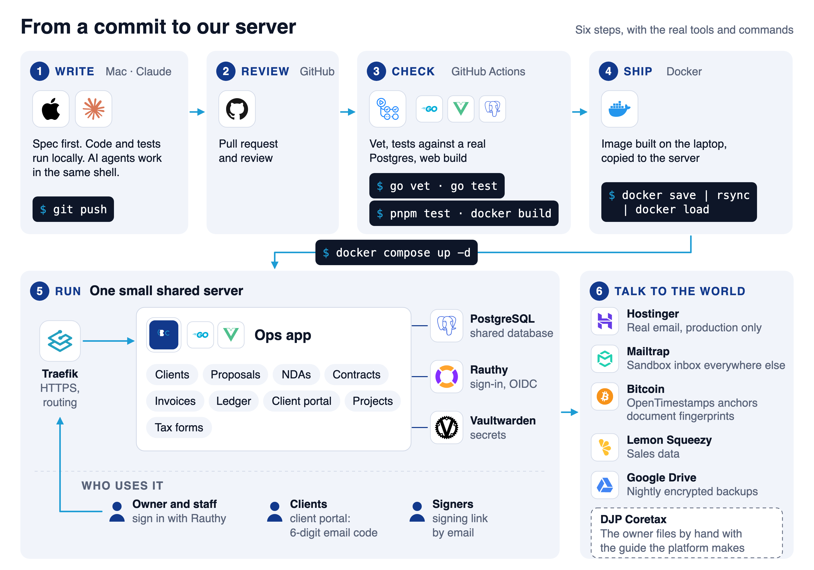
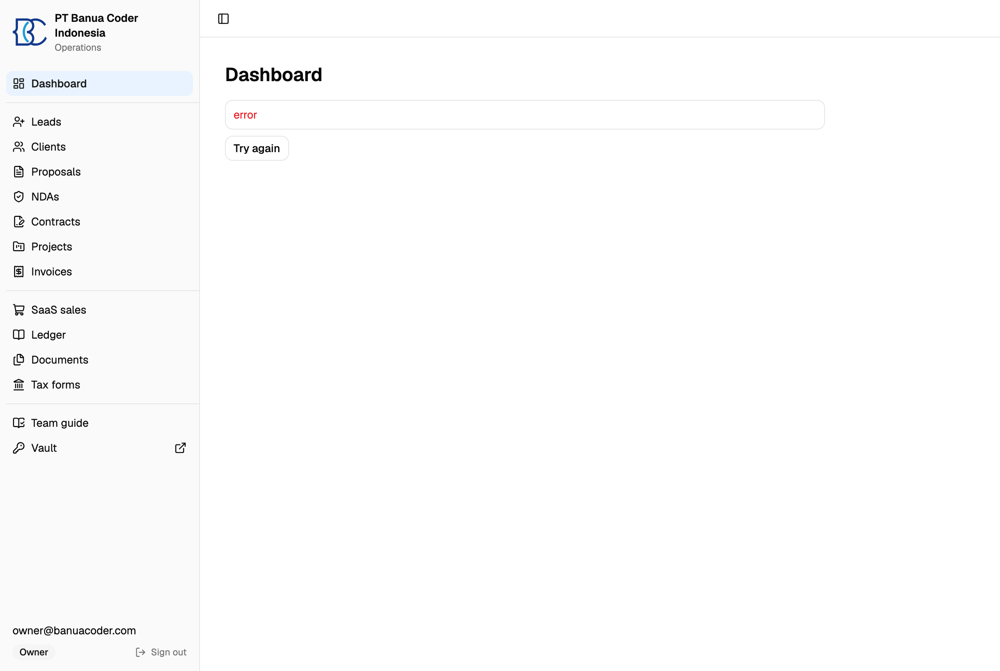

Banua Coder adalah perusahaan perangkat lunak kecil di Palu, Indonesia. Kami punya klien, kontrak, invoice, SPT tahunan, dan tim yang mulai bertambah. Cukup lama pekerjaan ini tersebar di banyak aplikasi dan di ingatan satu orang. Itu bermasalah saat orang tersebut cuti.

Karena itu kami membangun pusat operasional sendiri. Isinya satu program kecil yang berjalan di satu server bersama. Program ini menyimpan klien, dokumen, pembukuan, dan formulir pajak kami. Tulisan ini menjelaskan cara kerjanya dan pilihan yang kami ambil. Ada empat bagian: brankas rahasia, platform operasional, dokumen bertanda tangan yang bisa diverifikasi siapa saja, dan panduan untuk mengisi SPT di Coretax.

## Kenapa kami tidak membeli empat aplikasi lagi

Kebanyakan aplikasi yang kami lihat hanya menyelesaikan satu bagian. Invoice di satu tempat, kontrak di tempat lain, pembukuan di tempat ketiga. Masing-masing berbayar bulanan. Kami tidak menemukan satu yang menangani praktik Indonesia sekaligus. Praktik itu mencakup pemotongan PPh 23 oleh klien, kurs KMK, bea meterai, dan dokumen serah terima BAST dan SPPT.

Server kami kecil dan dipakai bersama layanan lain. Jadi kami ingin satu program ringan, bukan tumpukan aplikasi. Platform ini satu program Go dengan antarmuka Vue di dalamnya. Ia memakai database Postgres bersama. Proses masuk lewat penyedia identitas kami sendiri, Rauthy.

## Bagian 1: Brankas rahasia

Masalah pertama kami bukan platformnya. Masalahnya rahasia. Kunci tersimpan di pesan obrolan, di berkas `.env` yang disalin manual, dan di catatan bersama. Saat seseorang keluar, kuncinya tetap ada.

Kami menjalankan Vaultwarden sendiri. Ia memakai protokol Bitwarden, jadi staf memakai alat baris perintah resmi `bw`. Lima aturan membentuk desainnya:

1. Satu catatan aman untuk setiap proyek dan lingkungan, dengan nama seperti `lumbung/.env.staging`. Kolom catatan adalah nama variabel.
2. Akses diberikan per koleksi. Setiap orang hanya melihat proyek yang ia kerjakan. Untuk mencabut akses, pemilik menghapus orang itu dari koleksi, lalu merotasi rahasia yang bisa ia baca.
3. Satu perintah menarik catatan ke berkas lokal. Contohnya, `bw-env lumbung staging` menulis `.env.staging`. Kami tidak pernah meng-commit berkas itu.
4. Installer bertanda tangan. Pemilik menandatangani skrip dengan kunci yang tidak pernah berada di server. Installer tidak memasang apa pun kecuali tanda tangannya valid dan setiap berkas cocok dengan SHA-256 di daftar bertanda tangan.
5. `.env` di server dipasang dari catatan brankas, tidak pernah diubah manual. Perintah `bw-env-deploy` lebih dulu menampilkan apa yang akan berubah berdasarkan nama variabel. Ia tidak pernah mencetak nilai. Ia tidak menulis apa pun sampai Anda menambahkan `--apply`.

### Cara engineer atau freelancer mendapatkan env sebuah proyek

Engineer atau freelancer baru hanya butuh `.env` satu proyek dan tidak lebih. Untuk itu kami membuat tiga perintah kecil di atas Bitwarden CLI. Diagram di bawah menunjukkan seluruh jalurnya, langkah demi langkah.

1. Pemilik mengundang orang itu ke brankas dan menambahkannya ke koleksi proyek tersebut. Saran kami untuk freelancer: hanya koleksi staging, dengan kunci berhak akses rendah.
2. Orang itu menjalankan installer bertanda tangan dari situs ops kami: `curl -fsSL https://<ops-host>/install.sh | sh`. Installer memasang Bitwarden CLI dan perintah kami, dan berhenti bila tanda tangan pemilik atau hash berkas mana pun tidak cocok.
3. Orang itu menjalankan `bw login`. Kunci sesi tersimpan di Keychain macOS, jadi tidak ada permintaan kata sandi setiap kali.
4. Orang itu menjalankan `bw-env lumbung staging`. Perintah menulis `.env.staging` di folder proyek, dan berkas itu tidak pernah di-commit.
5. Saat pekerjaan selesai, pemilik mengeluarkan orang itu dari koleksi dan merotasi kunci yang bisa ia baca.

Ada tiga perintah. `bw-env` menarik catatan ke berkas. `bw-env-push` membuat catatan dari berkas `.env` yang sudah ada. `bw-env-deploy` menyamakan berkas di server dengan catatan. `bw-env-push` membuat satu kolom tersembunyi per variabel dan tidak pernah menimpa catatan. Dengan `--update`, perintah menampilkan nama variabel yang ditambah, diubah, dan dihapus sebelum mengubah apa pun.

Pipeline kami memakai akun brankas terpisah dengan akses baca saja ke satu koleksi bernama `CI`. Koleksi itu hanya berisi yang dibutuhkan pipeline, tidak pernah rahasia produksi. Sebuah GitHub Action kecil mengubah setiap kolom catatan menjadi variabel lingkungan yang disamarkan.

Sekarang soal agen AI. Mereka bekerja di shell yang sama dengan developer, jadi mereka menghadapi risiko yang sama. Aturan kami: agen boleh memakai nilai, tetapi tidak pernah membaca atau mencetaknya. Agen menjalankan `bw-env`, berkas jatuh ke disk, dan program yang membacanya. Nilai tidak masuk ke prompt atau obrolan. Dry run hanya menampilkan nama, dan itu cukup bagi agen untuk menalar sebuah perubahan.

Ini aturan, bukan tembok. Agen yang bisa menjalankan perintah shell bisa membaca berkas apa pun yang bisa dibaca developer. Karena itu akses dibatasi per proyek, dan kami merotasi rahasia setiap kali ada keraguan.

## Bagian 2: Satu platform untuk seluruh siklus

Platform ini mengikuti satu klien dari kontak pertama sampai invoice terakhir:

- Klien, dengan portal tempat klien masuk dan melihat proyeknya.
- Proposal, NDA, dan kontrak, dibuat dari template dalam Bahasa Indonesia atau Inggris.
- Invoice dalam beberapa mata uang, dengan PPh 23 dan kurs KMK pada tanggal terbit.
- Buku besar berpasangan (double-entry). Entri tidak pernah diedit. Koreksi dibuat sebagai pembalikan.
- Proyek dengan tahap sebelum pekerjaan, tahap sesudahnya, dan milestone.

Dokumen saling terhubung: NDA, proposal, kontrak, invoice, BAST, SPPT. Dari dokumen mana pun Anda bisa membuat dokumen berikutnya dengan data yang sudah terisi. Saat kontrak ditandatangani, platform membuat dokumen onboarding dan mengundang klien ke portal. Saat proyek selesai, platform membuat dokumen serah terima.

Portal klien menggantikan tautan rahasia. Klien memasukkan alamat email dan menerima kode enam digit. Setelah itu mereka melihat daftar onboarding, dokumen, invoice, dan papan tugas. Daftar onboarding terisi sendiri dari data nyata, jadi NDA yang sudah ditandatangani mencentang langkahnya sendiri.

## Bagian 3: Tanda tangan dengan jejak publik

Awalnya kami melihat alat tanda tangan yang di-hosting. Fitur embed-nya berbayar, dan alat itu butuh sekitar 2 GB memori di server kecil kami. Jadi kami membangun fitur tanda tangan di dalam platform.

Diagram di bawah menunjukkan alurnya. Setiap penanda tangan menerima tautan pribadi. Jika dokumen mencantumkan nilai di atas Rp 5.000.000, dokumen itu butuh bea meterai. Pemilik mengetik nomor seri dari Peruri. Platform tidak memanggil Peruri. Setiap tindakan masuk ke jejak audit yang hanya bisa ditambah: siapa, kapan, dari alamat mana, dan dari perangkat apa.

Saat penanda tangan terakhir selesai, platform membuat PDF final. Platform menambahkan halaman sertifikat dan kode QR, lalu menyimpan sidik jari SHA-256 dari berkas itu. Sidik jari tersebut dikirim ke kalender publik OpenTimestamps. Mereka menjangkarkannya di sebuah blok Bitcoin dalam sekitar sehari. Setelah itu, tidak ada yang bisa mengklaim berkas itu dibuat lebih lambat dari blok tersebut.

Kode QR membuka halaman verifikasi publik. Halaman itu menampilkan nomor dokumen, penanda tangan, sidik jari, dan status cap waktu. Judul disembunyikan kecuali pemilik mengizinkannya, karena judul sebuah NDA bisa bersifat rahasia.

Kami pernah membuat satu kesalahan di sini. Awalnya halaman menampilkan tanda "valid" hijau. Padahal halaman itu memeriksa salinan yang disimpan server kami, bukan PDF di tangan pembaca. PDF yang diubah dengan kode QR yang masih berfungsi tetap akan menuju halaman hijau. Sekarang halaman itu menulis "salinan kami masih utuh". Sebuah formulir memungkinkan pembaca mengunggah PDF mereka sendiri. Server menghitung hash-nya dan membandingkannya byte demi byte, lalu membuang berkasnya.

Satu batasan yang jujur. Ini adalah tanda tangan elektronik tidak tersertifikasi menurut hukum Indonesia (UU ITE). Tanda tangan ini sah, tetapi bobot pembuktiannya lebih rendah daripada tanda tangan dari penyedia tersertifikasi. Pengacara harus meninjau setiap template. Kami menyatakan ini di dalam platform.

## Bagian 4: Panduan Coretax

Inilah bagian yang paling kami syukuri sudah kami bangun.

Setiap tahun, SPT adalah hari paling berat. Formulir lama DJP berupa formulir XFA dari Adobe. Di Mac formulir itu menampilkan layar kosong "Please wait". Kami menulis parser untuknya dan mengisinya dari pembukuan kami. Lalu DJP memindahkan pelaporan ke Coretax, sistem web dengan formulir panjang. Jadi kami mengganti targetnya.

Halaman Tax forms sekarang membuat semuanya dari buku besar untuk tahun yang Anda pilih:

- Panduan Coretax. Panduan ini mengikuti layar Coretax pertanyaan demi pertanyaan, dengan jawaban yang diketik di samping setiap pertanyaan.
- PDF pendukung: laporan keuangan, neraca saldo, jurnal umum, buku besar, rincian biaya, rekapitulasi pendapatan, kredit pajak PPh 23, dan biaya dibayar di muka.
- Berkas zip berisi CSV untuk konsultan pajak.
- Angka tahunan, termasuk kerugian fiskal yang dikompensasikan dari tahun sebelumnya.

Platform tahu rezim pajak mana yang berlaku di setiap tahun dan menampilkan angka untuk rezim itu. Platform tidak pernah melaporkan apa pun. Setiap angka diberi tanda "verifikasi sebelum melapor", dan orang yang memahami pajak harus memeriksa angkanya sebelum Anda mengirim. Kami tidak pernah menampilkan angka pajak hasil hitungan sebagai angka final.

Kami belajar satu hal dengan cara sulit. Coretax menampilkan kesalahan parsing saat satu kolom tidak berisi angka. Panduan sekarang mencetak nol secara eksplisit di setiap sel. Angka negatif dicetak dengan tanda minus, karena tanda kurung pernah membuat kami mengetik tanda yang salah.

Semua tangkapan layar di tulisan ini memakai data contoh karangan.

## Cara kami membangun dan merilisnya

Setiap perubahan dimulai sebagai spesifikasi singkat. Lalu menjadi pull request di GitHub. GitHub Actions menjalankan pemeriksaan dan tes Go terhadap layanan Postgres, tes dan build web, dan build Docker. Proyek lain kami berbagi workflow yang dapat dipakai ulang dari satu repositori, sehingga pemeriksaannya sama di mana-mana.

Kami merilis dengan skrip. Skrip membangun image Docker di laptop, menyalin image ke server, dan menjalankannya dengan Docker Compose. Kami tidak membangun di server karena servernya kecil. Traefik memberinya HTTPS. Setiap malam, cadangan Postgres terenkripsi dikirim ke penyimpanan awan, dan dump bulanan disimpan selama sepuluh tahun yang dibutuhkan catatan keuangan.

Email nyata hanya terkirim bila pengaturan `APP_ENV=production` ada, dan hanya server yang memilikinya. Di tempat lain platform memakai kotak surat sandbox yang menangkap setiap pesan. Laptop atau tes tidak bisa mengirim email ke klien.

Kami membangun bersama tim agen AI. Ada agen backend, agen frontend, dan peninjau pajak. Peninjau pajak membaca angka dan alurnya tetapi tidak mengubah kode. Setiap perubahan tetap melewati pemeriksaan yang sama dan uji di browser sebelum dirilis.

## Sebelum Anda menirunya

1. Mulai dari buku besar. Invoice, laporan, dan formulir pajak semuanya membaca darinya.
2. Buat setiap pemeriksaan melihat benda di tangan pembaca, bukan hanya salinan Anda sendiri.
3. Jangan pernah menampilkan angka pajak hasil hitungan sebagai angka final.
4. Buat rilis tetap membosankan. Skrip yang bisa Anda baca lebih baik daripada pipeline yang tidak dipahami siapa pun.
5. Miliki sebuah sistem hanya bila Anda sanggup merawatnya. Biayanya adalah waktu kami, bukan langganan.

Banua Coder membangun sistem operasional internal seperti ini untuk perusahaan dan instansi pemerintah. Jika Anda menginginkannya, jadwalkan panggilan di banuacoder.com.
